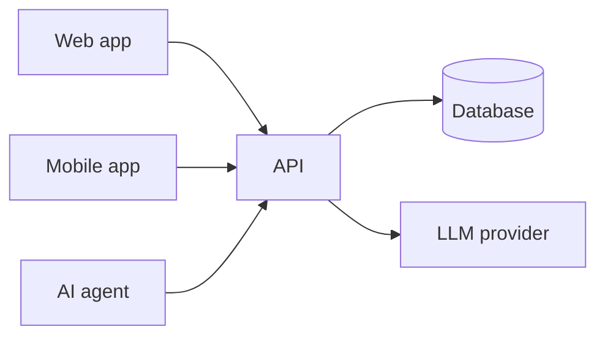

# Project name

A collaborative plateform to reference the software alternatives that can manages common task to help people keeping their old devices and reduce e-waste.

## Authors

| Name | GitHub | Main responsibilities |
|------|--------|-----------------------|
| Raphaël Letourneur | @raphltr | Developper |
| Oïlhan Mercul | @OilhanMercul | Developper |

<!-- Lab repository: one row. Project repository: both team members. -->

## Live system

| Part | URL |
|------|-----|
| Web app | … |
| API (+ docs) | … |
| Health check | … |
| Mobile app | build instructions below / APK in Releases |

## Architecture

See [docs/architecture.md](docs/architecture.md).



## Stack

| Part | Technology |
|------|------------|
| Backend | Node.js + Express |
| Web front end | React + Vite |
| Database / ORM | PostgreSQL + Prisma |
| Mobile | To be decided |
| Cloud | GitHub Actions + GHCR + Render |
| LLM provider | To be decided |

Reasons: see [docs/decisions/](docs/decisions/).

## Running locally

### Prerequisites
- Node.js 22 or later
- npm

### Configuration (secrets)
Describe which environment variables / user secrets are needed and how to set them.
**Never commit real secrets.**

Copy `.env.example` to `.env` and set a random `JWT_SECRET`.

### Start
```bash
npm install
npm run dev
```

### Tests
```bash
npm run build
npm run lint:openapi
```

Les tests fonctionnels de l'API sont réalisés avec Bruno. Ouvrir la collection
[api-tests/bruno](api-tests/bruno) dans Bruno, sélectionner l'environnement
`local`, puis exécuter les requêtes. Les tokens JWT sont renseignés dans
[local.bru](api-tests/bruno/environments/local.bru).

### Mobile app
How to build and run it, and how to point it to a local or production API.

## Documentation

| Document | Content |
|----------|---------|
| [docs/proposal.md](docs/proposal.md) | Problem, users, user stories |
| [docs/data-model.md](docs/data-model.md) | ER diagram |
| [docs/architecture.md](docs/architecture.md) | Components and deployment |
| [docs/api/openapi.yaml](docs/api/openapi.yaml) | REST API contract |
| [docs/agent.md](docs/agent.md) | Agent tools and guardrails |
| [docs/decisions/](docs/decisions/) | Architecture decision records |
| [docs/ai-usage-log.md](docs/ai-usage-log.md) | How we used AI tools |
