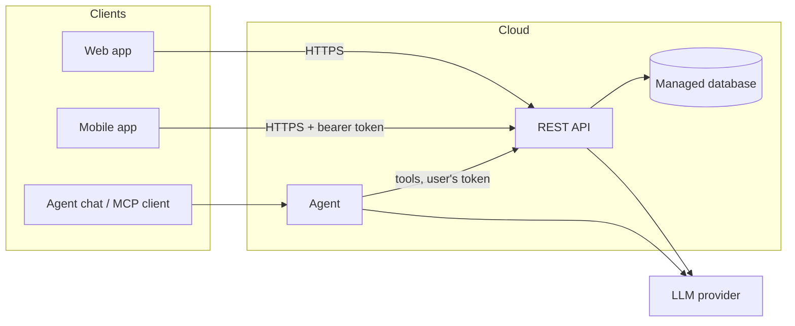
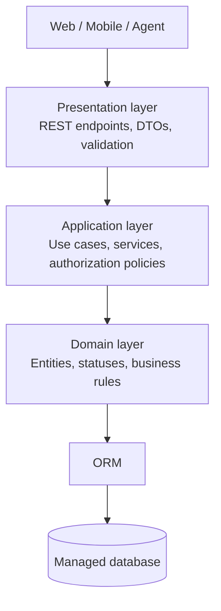
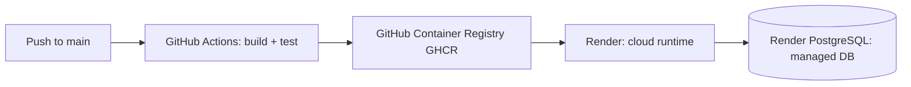

# Architecture

## Components

Update this diagram as the system evolves.

## Layers (backend)

The backend follows a layered architecture. HTTP endpoints do not contain business
rules and do not access the database directly.

### Presentation layer

- Exposes the REST API described by `docs/api/openapi.yaml`.
- Converts HTTP requests into input DTOs and validates them before calling a service.
- Converts service results into output DTOs; database entities are never returned directly.
- Maps authentication and authorization failures to structured Problem Details responses:
  `401` when no valid identity is available and `403` when the identity is not allowed.

### Application layer

- Contains the use-case services for registration, login, searching approved
  alternatives, submitting content, editing or deleting owned pending submissions,
  ratings, moderation and user-role management.
- Enforces authorization in the service boundary, including both role checks and
  ownership checks. Controllers must not be the only place where these checks occur.
- Coordinates repositories and transactions, then returns DTOs to the presentation
  layer.
- Keeps moderation rules consistent: new alternatives, tasks, devices and
  compatibility records remain pending until an administrator approves them.

### Domain layer

- Defines the domain entities documented in `docs/data-model.md`: `User`,
  `SoftwareAlternative`, `Task`, `Device`, `DeviceCompatibility` and `Rating`.
- Owns rules that must remain true regardless of the transport mechanism, including
  unique emails, scores from 1 to 5, one rating per user and alternative, valid
  moderation statuses, and the requirement for approved task/device associations
  before publication.
- Does not depend on HTTP, JWT, the ORM or the LLM provider.

## Authentication & authorization

Users authenticate with email and password. The API returns a short-lived JWT
bearer token; clients send it in the `Authorization` header over HTTPS. Passwords
are stored only as secure hashes, and JWT secrets are provided through the
environment.

There are two roles:

- `user`: searches approved alternatives, submits tasks, devices and alternatives,
  rates alternatives, and edits or deletes only their own pending submissions.
- `admin`: has all user permissions and can approve or reject submissions and
  manage user roles.

Authorization is enforced in the application/service layer for every protected
endpoint. Ownership is checked in addition to the role, so a user cannot modify
another user's content. Missing or invalid tokens return `401`; authenticated
users without the required role or ownership return `403`. The AI agent forwards
the authenticated user's token and cannot bypass these rules; destructive actions
require explicit user confirmation.

## Deployment

The deployment uses GitHub Actions, GitHub Container Registry (GHCR), Render (easier that AWS, Azure or Google cloud, postgres and express intergration) and
a managed PostgreSQL database. Every push to `main` triggers the build and tests;
the validated Docker image is then deployed to Render over HTTPS.

Secrets (JWT key, database URL and LLM API key) are stored as Render environment
variables and are never committed to the repository. Application logs are
available in Render, and `/health` is used for monitoring and deployment checks.

