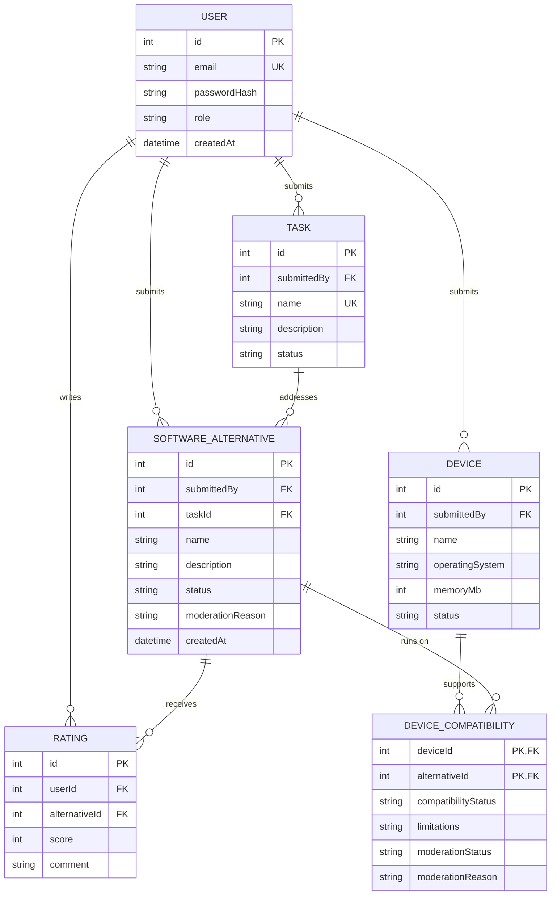

# Data Model

The platform stores software alternatives and the tasks and devices they support.

## Entities

| Entity | Description | Important rules / constraints |
|--------|-------------|-------------------------------|
| `User` | A person who searches, contributes or administers the platform. | `role` is `user` or `admin`; email is unique. |
| `SoftwareAlternative` | A software solution proposed for one primary task and one or more compatible devices. | A new submission is `pending` until approved by an admin; only approved alternatives are public. |
| `Task` | An activity that a user wants to perform, such as editing text or playing music. | The name is unique; a task is `pending` until approved by an admin; one task can have many alternatives. |
| `Device` | A device and its relevant hardware or operating-system constraints. | A device is `pending` until approved by an admin and can be compatible with many alternatives. |
| `DeviceCompatibility` | Associative entity describing whether an alternative works on a device. | The pair `(deviceId, alternativeId)` is unique and must contain compatibility information. |
| `Rating` | A score and optional comment written by a user about an alternative. | A user can rate an alternative at most once; the score is between 1 and 5. |

## Business rules

- A software alternative is visible in public search only after an admin approves it.
- A task or device is used in public search only after an admin approves it.
- A user can edit or delete only their own pending submissions.
- An admin can moderate submissions and manage user roles.
- Every published alternative must be associated with one approved task and at least one approved device.
- A task can be linked to many software alternatives; each alternative has one primary task in the first version.
- A device can be linked to many software alternatives, and an alternative can support many devices.

## Structure rationale

The first version uses one primary `Task` per `SoftwareAlternative`. This creates a simple `1:N` relationship that is sufficient for the Must stories: users search by a task, submit an alternative for a task, and administrators validate the task. Supporting several tasks per alternative could be added later with a task join entity, but it is intentionally outside the initial scope.

The relationship between `Device` and `SoftwareAlternative` is `M:N`, because one alternative can run on many devices and one device can support many alternatives. `DeviceCompatibility` is therefore a join entity rather than a simple link: it stores compatibility status, limitations and moderation information that belong to the relationship itself.

`User` owns submissions and ratings, which makes ownership authorization testable. Status and moderation-reason fields keep pending or rejected content out of public search and give administrators a traceable moderation workflow.
